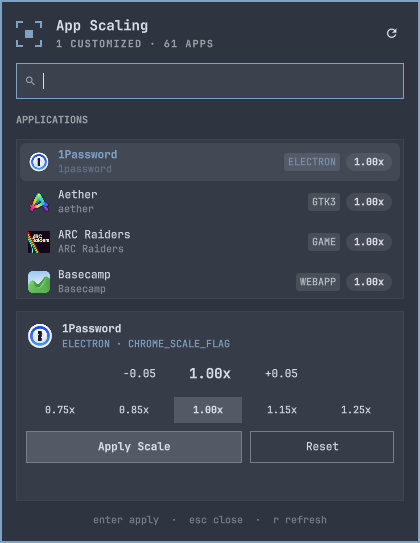
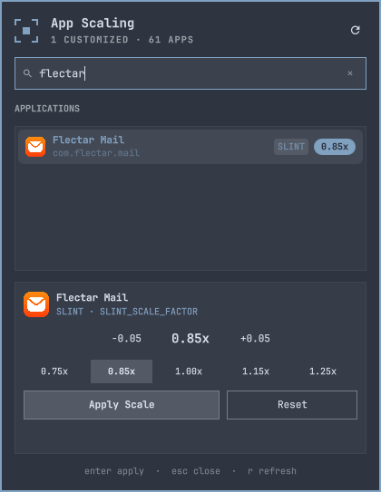
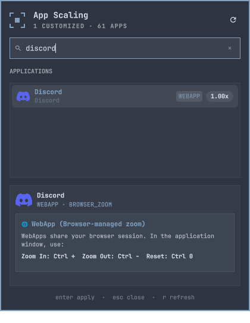

# omarchy-app-scaling

Per-application scaling manager popover for [Omarchy](https://omarchy.org/) Linux.

Allows overriding the UI scaling factor of individual applications without altering global monitor scaling. Automatically inspects ELF binaries and wrapper scripts to detect application toolkits deterministically and injects the optimal scaling environment variable or command-line flag into user desktop entries (`~/.local/share/applications/*.desktop`).

<p align="center">
  
  &nbsp;&nbsp;
  
</p>

---

## Supported Toolkits & Strategies

| Toolkit | Detection Criteria | Scaling Strategy |
| :--- | :--- | :--- |
| **Slint** (Rust) | ELF symbols `SLINT_SCALE_FACTOR`, `slint_core`, `slint::` | `env SLINT_SCALE_FACTOR=<scale>` |
| **Qt 6** | Dynamic dependency `libQt6Core.so` | `env QT_SCALE_FACTOR=<scale>` |
| **Qt 5** | Dynamic dependency `libQt5Core.so` | `env QT_SCALE_FACTOR=<scale>` |
| **GTK 4** | Dynamic dependency `libgtk-4.so` | `env GDK_SCALE=1 GDK_DPI_SCALE=<scale>` |
| **GTK 3** | Dynamic dependency `libgtk-3.so` | `env GDK_SCALE=1 GDK_DPI_SCALE=<scale>` |
| **Electron / Chromium** | ASAR archive, `force-device-scale-factor` flag | `--force-device-scale-factor=<scale>` |
| **WebApps / PWAs** | `omarchy-launch-webapp`, `--app=` flag, `chrome-*` class | In-browser zoom (`Ctrl +` / `Ctrl -` / `Ctrl 0`) |
| **Java** (AWT/Swing/JavaFX) | Executable `java` or `libjvm.so` | `-Dsun.java2d.uiScale=<scale>` |
| **Unrecognized Engine** | Unidentified binaries or custom engines | `UNIVERSAL_FALLBACK`: Injects markers for every supported engine (`QT_SCALE_FACTOR`, `GDK_DPI_SCALE`, `SLINT_SCALE_FACTOR`), with no guarantees |

### WebApps

WebApps use browser zoom rather than managed scaling flags. Selecting one shows the keyboard shortcuts instead of scale controls:

<p align="center">
  
</p>


---

## Installation

### Via Omarchy Plugin Manager

```bash
omarchy plugin add https://github.com/phenome/omarchy-app-scaling.git --enable
```

### Removal

To remove the plugin and CLI symlink:

```bash
# Disable and uninstall the shell plugin
omarchy plugin remove phenome.app-scaling

# Remove the CLI symlink
rm -f ~/.local/bin/omarchy-app-scaling ~/.local/bin/omarchy-app-dpi
```

To reset scaling on all customized applications before uninstalling, run `omarchy-app-scaling reset <app-id>` for each overridden app.

### Dependencies

- **Omarchy Linux** (Quickshell shell)
- **Bun** runtime (preinstalled on Omarchy)
- `desktop-file-utils` (`desktop-file-validate` and `update-desktop-database`, standard system utilities)

---

## CLI Usage

### List Installed Applications

```bash
# Formatted list
omarchy-app-scaling list

# Filtered search
omarchy-app-scaling list --search chrome

# JSON output
omarchy-app-scaling list --json
```

*(Alias: `omarchy-app-dpi`)*

### Inspect an Application

```bash
omarchy-app-scaling inspect com.flectar.mail
omarchy-app-scaling inspect google-chrome
```

### Set Scaling Factor

```bash
# Scale Flectar Mail to 85%
omarchy-app-scaling set com.flectar.mail 0.85

# Scale Chrome to 125%
omarchy-app-scaling set google-chrome 1.25
```

### Reset to Default Scaling

```bash
omarchy-app-scaling reset com.flectar.mail
```

### Applying a Saved Scale

The saved scale describes the application's `.desktop` launch settings, not a measured scale of its running windows. Fully quit the application (including its tray/background instance), then launch it through its desktop entry to apply the setting. Closing a window may leave the application running.

Omarchy's packaged 1Password hotkey (`SUPER + SHIFT + SLASH`) uses a launcher that hardcodes `--force-device-scale-factor=1`, bypassing the saved desktop setting. Replace only that binding in `~/.config/hypr/bindings.lua`:

```lua
o.rebind("SUPER + SHIFT + SLASH", "Passwords", "uwsm-app -- gtk-launch 1password.desktop")
```

This resolves the user desktop override when present, or the system desktop entry otherwise. Direct binary launches and autostart commands may still bypass desktop settings. This launch-path correction is not a claim that 1Password's visual scaling has been verified.

---

## Keyboard Shortcut

To open the graphical scaling manager with `SUPER + CTRL + D`, add the following to `~/.config/hypr/bindings.lua`:

```lua
o.rebind("SUPER + CTRL + D", "App Scaling", { panel = "phenome.app-scaling" })
```

Then reload Hyprland bindings:

```bash
hyprctl reload
```

---

## Development & Linting

This repository uses [Biome](https://biomejs.dev/) for code linting and formatting, [Lefthook](https://github.com/evilmartians/lefthook) for Git pre-commit hooks, and Bun's native typechecker:

```bash
# Typecheck
bun check

# Lint & check formatting
bun run lint

# Format code
bun run format
```

---

## License

MIT © [phenome](https://github.com/phenome)
